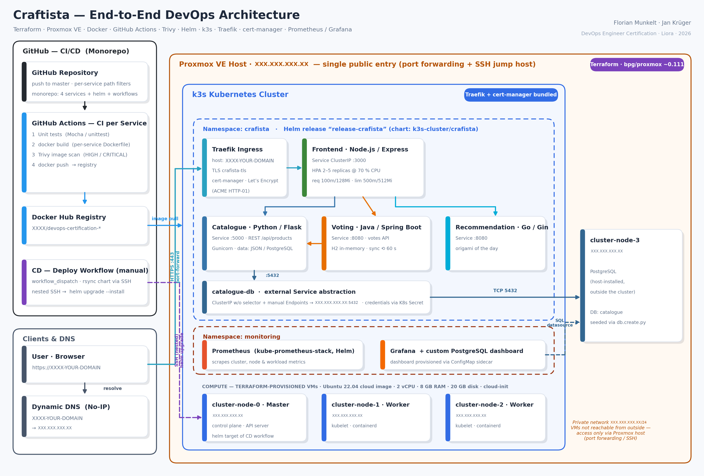

# Craftista DevOps Platform

**From virtual machines to a monitored, HTTPS-secured Kubernetes platform.**

An end-to-end DevOps project demonstrating infrastructure automation, containerized microservices, CI/CD pipelines, Kubernetes orchestration, automated TLS, and observability on self-hosted infrastructure.

**Project contributors:** Florian Munkelt & Jan Krüger

[Architecture](#architecture) · [Tech Stack](#tech-stack) · [CI/CD](#cicd--delivery) · [Getting Started](#getting-started)

---

## Architecture



The platform runs on Proxmox VE and uses Terraform to provision virtual machines. A lightweight k3s cluster hosts the application, while PostgreSQL runs on a dedicated VM. GitHub Actions automates image builds and security scans, with a separate deployment workflow for controlled releases.

External application traffic is routed through Traefik, with TLS certificates managed by cert-manager and Let's Encrypt. Prometheus and Grafana provide monitoring and visualization.

## Tech Stack

| Area | Technologies |
|---|---|
| Infrastructure as Code | Terraform, Proxmox VE, cloud-init |
| Containers | Docker, Docker Compose, multi-stage builds |
| CI/CD & Security | GitHub Actions, Trivy, Docker Hub |
| Orchestration | Kubernetes, k3s, Helm, HorizontalPodAutoscaler |
| Networking & TLS | Traefik, cert-manager, Let's Encrypt |
| Database | PostgreSQL |
| Observability | Prometheus, Grafana |

## Key Engineering Highlights

- **Reproducible infrastructure:** Terraform provisions virtual machines from a shared cloud-init template.
- **Automated CI pipelines:** Path-based GitHub Actions workflows build and scan application-specific container images.
- **Controlled delivery:** Image builds and cluster deployments are separated by a manual release trigger.
- **Kubernetes deployment:** Helm manages application releases on a three-node k3s cluster.
- **External database integration:** Kubernetes Services and Endpoints decouple application workloads from the PostgreSQL VM's network location.
- **Secure access and observability:** Traefik, automated TLS certificates, Prometheus, and Grafana provide the foundation for secure access and operational visibility.

## CI/CD & Delivery

The delivery workflow follows this sequence:

`Git Push → Build → Trivy Scan → Docker Hub → Manual Deployment → Kubernetes`

Application changes trigger the corresponding CI workflow. The deployment workflow provides a deliberate release gate before changes are applied to the private Kubernetes environment through SSH jump-host connectivity.

## Getting Started

### Run locally

Requirements: Docker and Docker Compose.

```bash
docker compose up --build
```

Open `http://localhost` in your browser.

### Deploy to your own infrastructure

The full deployment requires Proxmox VE, Terraform, a configured k3s cluster, registry credentials, and environment-specific settings.

See [`infra/terraform/`](infra/terraform/) for infrastructure provisioning and the repository workflows for build and deployment automation.

## Roadmap

- [ ] Immutable image tags based on Git commit SHAs
- [ ] Enforced vulnerability thresholds in CI
- [ ] Encrypted secret management
- [ ] Automated deployment smoke tests
- [ ] GitOps delivery with Argo CD
- [ ] PostgreSQL backup and recovery automation
- [ ] Centralized logging and alerting

## Project Context & Credits

This project was developed as the final project of the DevOps Engineer certification program at Liora · Université Paris 1 Panthéon-Sorbonne, Formation Continue.

The application is based on [Craftista](https://github.com/craftista) by School of DevOps, licensed under Apache 2.0. The infrastructure, CI/CD pipelines, deployment configuration, and monitoring components were developed by Florian Munkelt and Jan Krüger.

See the repository's license files for the applicable licensing terms.

---

**Focus:** Infrastructure as Code · CI/CD Automation · Kubernetes · Cloud-Native Delivery · Observability